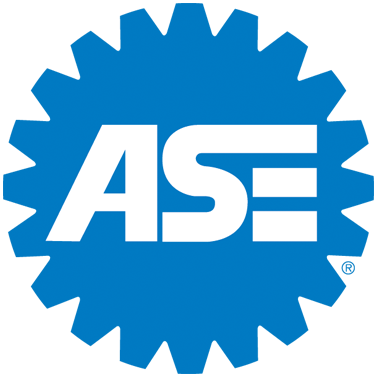
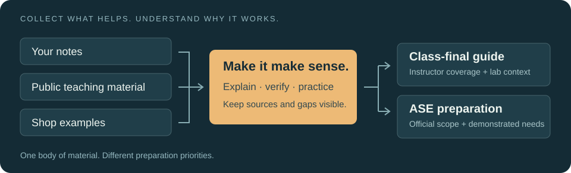

<p align="center">
  <sub>Study context and reference organizations</sub><br><br>
  <a href="https://ase.com/"></a>
  &nbsp;&nbsp;&nbsp;
  <a href="https://www.gm.com/"></a>
  &nbsp;&nbsp;&nbsp;
  <a href="https://gmasep.org/"></a>
</p>

<p align="center"><sub>Independent student project. Not an official study guide or official course material.<br>Not affiliated with, sponsored by, or endorsed by ASE, GM, GM ASEP, or a college.</sub></p>

<h1 align="center">ASEP Study Workflow</h1>

<p align="center">
  <strong>Turn notes, shop experience, and the open web into useful automotive prep.</strong><br>
  A reusable framework and shared skill for Claude Code and Codex.
</p>

<p align="center">
  
</p>

<p align="center">
  <a href="#start-here">Start here</a> ·
  <a href="#use-with-claude-or-codex">Use the skill</a> ·
  <a href="skills/ase-study/references/design.md">Design</a> ·
  <a href="skills/ase-study/references/sources.md">Sources</a> ·
  <a href="skills/ase-study/references/pathways.md">A2 → A8 → L1</a>
</p>

---

Your notes might be detailed, scattered, or still unwritten. Start with what you have—or ask an assistant to find public course notes, lecture material, diagrams, and explanations. Check the important claims, connect them to shop examples, and build understanding while the material is fresh.

The result is **two different guides from one body of material**:

| Guide | What determines the scope |
|---|---|
| **Class final** | Your instructor's coverage, textbook material, notes, and labs. |
| **ASE preparation** | The whole relevant folder, verified research, official task coverage and weighting, and your demonstrated needs. |

Born from a [GM ASEP](https://gmasep.org/) drivetrain study workflow. The same method supports other automotive programs and independent learners. Use it manually, with one assistant, or with one drafting and another reviewing.

> [!NOTE]
> This is a working framework and empty course scaffold. It includes no complete A2/A8/L1 curriculum, secure exam questions, or promised pass rate. Independent project; not affiliated with or endorsed by ASE, GM, or a college.

## What is ready

| Status | Component | Evidence or boundary |
|---|---|---|
| Ready | Workflow, design, source strategy | Documents included; supports personal notes, public sources, and hybrid work. |
| Ready | Shared `ase-study` skill | Format and references checked. Full assistant study sessions remain to be evaluated. |
| Verified | Local course generator | A2, A8 and L1 scaffolds exercised; existing folders preserved; invalid input rejected. |
| Planned use | Automatic transmission, engine performance, advanced engine performance | Adaptation guidance included; technical course content comes later. |
| Unmeasured | Exam outcomes | No controlled effectiveness study or validated readiness scoring. |

---

## Start here

**Just want the method?** Read the [workflow](skills/ase-study/references/workflow.md). No software setup is needed to use it.

**Want a fresh course folder?** Requires Git and Python 3.9+; no Python packages or API keys.

```sh
git clone https://github.com/flyboy-byte/asep-study-workflow.git
cd asep-study-workflow
python3 skills/ase-study/scripts/new_course.py ../my-ase-course --exam A2
```

Open `../my-ase-course/CONTEXT.md`. Add notes when you have them, or request web-first research when ready. The generator creates context, workflow, research and agent instructions, plus `notes/`, `study/`, and `sources/`. It refuses to overwrite an existing destination. For an established folder, adapt the roles to your files instead of forcing a new layout.

> [!TIP]
> Personal course files are ignored by Git by default. Start with a local course folder. You can later publish selected original notes and guides after reviewing their sources and identifying details; avoid uploading an entire working folder by accident.

## Use with Claude or Codex

Both tools can load the same skill folder. From the cloned repository, link only the tool locations you use:

```sh
# Codex
mkdir -p "$HOME/.agents/skills"
ln -s "$PWD/skills/ase-study" "$HOME/.agents/skills/ase-study"

# Claude Code
mkdir -p "$HOME/.claude/skills"
ln -s "$PWD/skills/ase-study" "$HOME/.claude/skills/ase-study"
```

Keep the clone in place while using these links. If the name is already installed, inspect it instead of replacing it blindly. Copying the entire `skills/ase-study/` directory into the appropriate skill location is an alternative to symlinks.

Open your **course folder** in the assistant. Invoke `$ase-study` in Codex or `/ase-study` in Claude Code, followed by your request. Automatic selection is also allowed. If the skill does not appear, restart the assistant. See the official [Codex skill documentation](https://learn.chatgpt.com/docs/build-skills) and [Claude Code skill documentation](https://code.claude.com/docs/en/skills).

| You say | The workflow does |
|---|---|
| “Document the framework; this class starts later.” | Preserves the design and future intent without starting course prep. |
| “I added notes. Update the unit material.” | Reads changes, updates the guide, records coverage and open questions. |
| “I have no notes. Find useful public material for this ASE.” | Builds a source map, verifies claims, and identifies remaining gaps. |
| “Quiz me on what we've covered.” | Uses explanations and unfamiliar examples; records meaningful misses. |
| “Use the whole folder to build my final/ASE guide.” | Synthesizes the relevant corpus around the requested exam scope. |

---

## How the work accumulates

Collect → explain → map coverage → research → practice → synthesize.

Public student notes can reveal a helpful explanation or common misunderstanding. Manufacturer information can establish a specification. Official ASE documents establish exam coverage. Each source has a job; several copies of the same notes do not count as independent confirmation.

Keep raw material intact, research in one place, and handoffs in the course context. The assistant should remember through files which material was actually read, what remains uncertain, and what the learner can explain—not merely how many documents exist.

<details>
<summary><b>Explore the framework</b></summary>

<br>

| File | Purpose |
|---|---|
| [Design](skills/ase-study/references/design.md) | Intent, source priorities, learner-specific decisions, and boundaries. |
| [Workflow](skills/ase-study/references/workflow.md) | Intake, research, study, final synthesis, and cross-assistant handoff. |
| [Source strategy](skills/ase-study/references/sources.md) | Public notes, broad web research, primary-source checks, and access records. |
| [Subject pathways](skills/ase-study/references/pathways.md) | Reuse across courses, including later A8 and L1 preparation. |
| [Skill](skills/ase-study/SKILL.md) | Portable instructions with references and course templates. |
| [Project state](PLAN.md) | Implemented work, verification, limitations, and future evaluation. |

</details>

## Contribute or adapt

Useful contributions include clearer workflows, tested scaffold fixes, source-selection improvements, and selected learner-authored notes or examples you have permission to share. Link official references and explain what a source actually supports. Keep private records, commercial books, secure test content and unsupported readiness claims out of contributions.

Original framework, documentation and code are [MIT licensed](LICENSE). Linked third-party material and the [organization logos](docs/branding.md) retain their own rights and are excluded from the MIT license. The framework originated in student-led use of Claude and Codex; this reusable package was drafted and checked with Codex.
