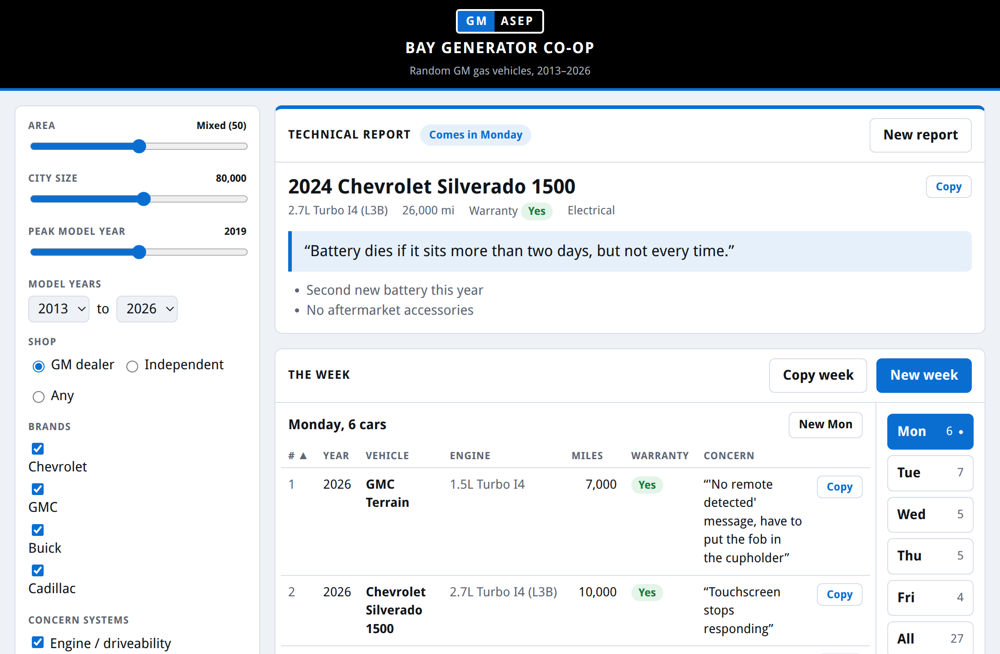

# asep-study: GM ASEP study guides, ASE prep and a bay generator

> [!NOTE]
> This is one GM ASEP student's study workspace, shared with classmates. The guides are built from class notes,
> official ASE task lists and outside research with help from Claude (Anthropic). They are study aids, not service
> information. Check specs and procedures in GM SI before using them on a car.

**Try the bay generator: [flyboy-byte.github.io/asep-study](https://flyboy-byte.github.io/asep-study/)**

<p align="center"></p>

The bay generator gives you a week of random GM gas vehicles (2013–2026) that could roll into your bay, plus one
harder **technical report**, the one you'd tell a friend about. Each car has an engine, mileage, whether warranty
pays, and the customer's concern in their own words. It never gives the cause, because diagnosing it is your job.
Regenerate the week, a single day or the report, sort the list, and copy any car straight into a text. Use Settings
to move from city to farm country, change the town's size, or switch between a GM dealer and an independent shop,
and the traffic changes the way it would in real life. It works on a phone too.

---

## Courses

| | Exam | Folder | What's there |
|---|---|---|---|
| ✅ | **A3** Manual Drive Train & Axles | [`mantrans/`](mantrans/) | Class done. ASE guide, simple sheet and cram sheet, plus unit and class-final guides. |
| ✅ | **A2** Automatic Transmissions | [`autotrans/`](autotrans/) | **Passed.** ASE guide, simple sheet and cram sheet, plus unit and final-prep guides. |
| 🚧 | **A8** Engine Performance | [`engine-performance/`](engine-performance/) | Official ASE task list mapped and weighted. Waiting on class notes (spring). |
| 🚧 | **L1** Advanced Engine Performance | [`l1/`](l1/) | Official guide and Composite Vehicle Type 4 booklet saved, task list weighted. Passing A8 comes first. |
| ⬜ | L2, L3 | `l2/`, `l3/` | Not started. |

### Printable guides (PDF)

| Exam | ASE prep | Class |
|---|---|---|
| A3 | [Study guide](mantrans/study/ase/ase_a3_study_guide.pdf) · [Simple sheet](mantrans/study/ase/ase_a3_simple_sheet.pdf) · [Cram sheet](mantrans/study/ase/ase_a3_cram_sheet.pdf) | [Unit 2](mantrans/study/unit2_study_guide.pdf) · [Unit 3](mantrans/study/unit3_study_guide.pdf) · [Class final](mantrans/study/class_final_study_guide.pdf) |
| A2 | [Study guide](autotrans/study/ase/ase_a2_study_guide_v2.pdf) · [Simple sheet](autotrans/study/ase/ase_a2_simple_sheet_v2.pdf) · [Cram sheet](autotrans/study/ase/ase_a2_cram_sheet_v2.pdf) | [Unit 1](autotrans/study/unit1_study_guide.pdf) · [Unit 2](autotrans/study/unit2_study_guide_v2.pdf) · [Final prep](autotrans/study/final_prep_v2.pdf) |

- The **study guide** is the full read.
- The **simple sheet** covers the core ideas on a few pages.
- The **cram sheet** is the last look before the test.

The ASE guides follow the official ASE task list and its weights. The class guides follow what the instructor
covered. None of them include practice questions, so use your Motor Age or GM training question banks for those.

---

## How it's built

Each course folder is laid out the same way:

| Folder or file | What it holds |
|---|---|
| `notes/` | Raw class notes and photos, kept as written |
| `research.md` (A3: `a3_research_foundation_*.md`) | Official ASE coverage, outside sources and corrections. Each claim is tagged DOCUMENTED, INFERRED or OPEN |
| `study/` | Generated guides as Markdown, HTML and letter-size PDF |
| `sources/` | Outside references (ASE guides, manufacturer documents) |
| `CONTEXT.md` | The folder's current state: dates, what's done, what's next |

The process is written up in [`workflow/`](workflow/) as a reusable skill (`ase-study`), so another student can use
it with their own notes. [`tools/studybuild.py`](tools/studybuild.py) turns a guide's Markdown into the printable
HTML and PDF.

<details>
<summary><b>Bay generator: run it locally or change it</b></summary>

<br>

The Python version is the original and has the same controls in a desktop window:

```sh
python3 bay-gen/bay_gen.py                     # window (tkinter)
python3 bay-gen/bay_gen.py --cli -n 8          # one batch in the terminal
python3 bay-gen/bay_gen.py --cli --week --sat  # a work week with a Saturday
```

The vehicle list, engines, concerns and odds are plain Python in `bay-gen/fleet.py`, `concerns.py` and
`bay_gen.py`. After editing them, run `python3 bay-gen/export_web.py` to refresh the website's data. A push to
`main` redeploys the site. [`bay-gen/README.md`](bay-gen/README.md) explains how each row is built and which
warranty terms are used.

</details>

<details>
<summary><b>Setting up on a new machine</b></summary>

<br>

```sh
gh repo clone flyboy-byte/asep-study ~/projects/asep-study
cd ~/projects/asep-study   # start Claude Code here or in a course folder
```

The `ase-study` skill loads from `.claude/skills/ase-study`, a link to `workflow/skills/ase-study`. The PDFs are
already committed. To make new PDFs that match the existing ones, you need Chrome (for headless printing) and the
claude-paper styling reference (`~/Downloads/whitepaper-formatter.html`, which isn't in the repo).

</details>

---

## Layout

```
asep-study/
├── mantrans/            A3 Manual Drive Train & Axles
├── autotrans/           A2 Automatic Transmissions
├── engine-performance/  A8 Engine Performance
├── l1/                  L1 Advanced Engine Performance
├── l2/  l3/             placeholders
├── bay-gen/             bay generator (Python + web/ for the site)
├── tools/               studybuild.py: Markdown → HTML + PDF
└── workflow/            the reusable process and ase-study skill
```

Not affiliated with GM or ASE. Vehicle and engine names belong to their owners.
