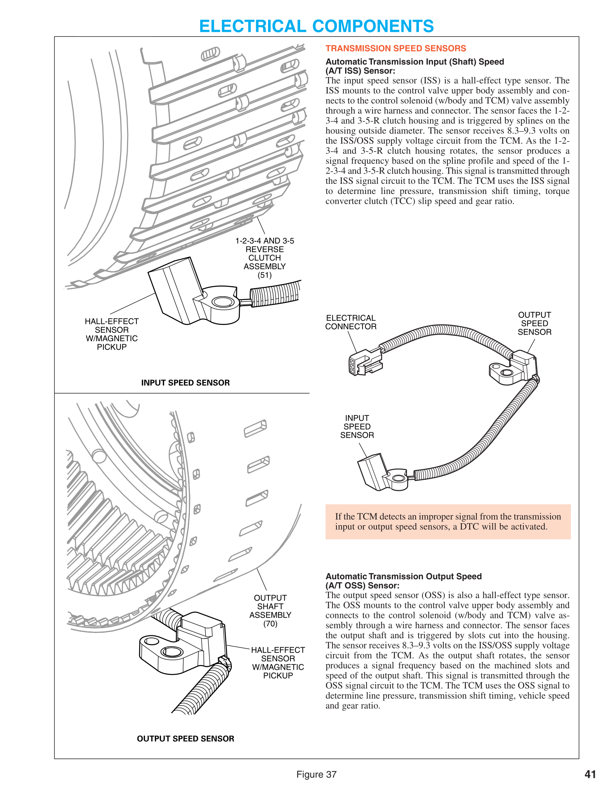

# Unit 1 Study Guide — Automatic Transmission Fundamentals
*(GM ASEP A2, Unit 1 — everything in the notes so far: power flow/planetary basics, apply devices, hydraulics, and electronic controls. Built from class notes, not the ASE task list.)*

---

## Page 1 — Power Flow & Planetary Gear Fundamentals

### The core idea
A manual transmission physically connects gears with a sleeve/synchronizer assembly. An automatic transmission does the same job a different way: **a clutch pack, pushed by hydraulic pressure, locks the gear connection instead.** The ability to "stall" while in gear belongs to the torque converter, not the transmission — once a gear is engaged, turning the input shaft mechanically turns the output shaft.

### Simple planetary gear set
Three members, always in mesh:

| Member | Role |
|---|---|
| **Sun gear** | Center of the set. |
| **Planet carrier** (+ pinion/planet gears) | Holds the pinions, which revolve around the sun gear and stay in constant mesh with both the sun and the ring gear. |
| **Ring (annulus) gear** | Outermost member, internal teeth. |

**One member is held (reaction), one is driven (input), one is the output.** Two members held/driven together = direct drive. None held = neutral. Adding more planet pinions doesn't change the ratio — it only adds strength.

### General planetary rules (recognize, then verify)
| Result | Condition |
|---|---|
| Neutral | No driving member or reaction member |
| Forward direct drive, 1:1 | Two members are driven |
| Forward reduction | Carrier is the output |
| Forward overdrive | Carrier is the input |
| Reverse, reduction or overdrive | Carrier is the reaction member |
| Forward or reverse overdrive | Sun gear is the output |
| Forward or reverse reduction | Sun gear is the input |
| Reverse rotation | One external gear drives another external gear |
| Same-direction rotation | An external gear drives an internal gear, or vice versa |

Identify the actual input, reaction, and output members in the diagram *before* applying these rules.

### Calculating gear ratios
A simple planetary set produces seven ratios plus neutral, depending on which member is driven and which is held:

- Ring held, sun driven → reduction (torque up, speed down).
- Ring held, carrier driven → overdrive (reciprocal of the above).
- Sun held, ring driven → reduction.
- Sun held, carrier driven → overdrive (reciprocal of the previous).
- Carrier held, sun driven → reverse reduction.
- Carrier held, ring driven → reverse overdrive (reciprocal of the previous).

You don't need every formula memorized cold, but you should be able to work through *which member is doing what* and get the ratio type right if given the reference material.

### Compound gear sets (combining simple sets)
| Set | Built from | Used for |
|---|---|---|
| **Simpson** | Two ring gears + two planet carriers sharing **one sun gear** | 4- and 5-speed transmissions |
| **Ravigneaux** | One carrier with two sets of planet gears + **two sun gears** + one ring gear | Combined with a simple set for 6–8 speeds |
| **LePelletier** | A Ravigneaux set + a simple planetary set | 6, 7, 8-speed transmissions (e.g. Ford 6R60/6R80, GM 6L80E) |

In a LePelletier train, the ring gear is always an input and the sun gear is always a reaction member (splined to the pump), so the simple set is always in reduction — it feeds a reduced-speed input into the Ravigneaux set, which has three possible inputs and two reaction members.

**Instructor note: you don't need to memorize the full power flow.** You do need the basic concepts — what a planetary set is, how ratios are determined, and the difference between gear set families.

### Ratio-spread reasoning (why 8/9/10-speed exists)
More ratios → lower first gear (better launch), higher overdrive ratios (lower engine speed at highway speed → better fuel economy and lower emissions). Eight/nine/ten-speed gear sets are hard to classify into one simple type — they combine more than one compound set. Always check service information for the actual design rather than assuming a family.

### Synchronous vs. nonsynchronous shifts
| Type | What it means | Uses a one-way clutch? |
|---|---|---|
| **Synchronous** (overlap / clutch-to-clutch) | The new driving/reaction member must be *timed* with the release of the old one. A band must release and reapply at an exact moment. | No |
| **Nonsynchronous** (asynchronous / freewheel) | A one-way clutch self-releases (overruns) the instant the next member applies — no timing needed. | Yes |

**Memorize:** synchronous shifts don't use a one-way clutch; nonsynchronous shifts do. Mistiming a synchronous (clutch-to-clutch) shift risks applying two ratios at once — a very harsh shift, or a flare if the timing goes the other way. Most modern transmissions are fully synchronous.

---

## Page 2 — Apply Devices, Shift Quality & the Illustrated 10-Speed

### Clutch packs
Alternating **frictions** (fiber plates) and **steels** (separator plates), finished with a pressure plate retained by a snap ring. Unapplied plates need clearance to stay cool, avoid drag, and let fluid pass between them. Fluid feeds from the shaft into the drum, sealed with sealing rings.

A **controlled release** matters as much as apply timing for synchronous shifts — most transmissions use a return spring pack, though some use fluid on both sides of the piston when release needs to be faster than a spring alone.

### Bands and servos
A **band** is a lined metal strip that wraps a drum to prevent it from rotating — rigid (thick) or flexible (thin/flex) types. A **servo** is the hydraulic assembly (piston) that applies the band, using hydraulic pressure to move a piston that tightens the band.

### One-way clutches (holding or driving members)
| Type | How it works |
|---|---|
| **Roller clutch** | Roller bearings lock into a ramped outer race. |
| **Sprag clutch** | Hourglass-shaped sprags between smooth inner/outer races; major diameter > race gap, minor diameter < race gap. |
| **Mechanical diode** | Spring-loaded rectangular struts (pocket plate) engage notches (notch plate); stronger than a roller or sprag design. Think of a ratchet wrench. |

A one-way clutch applies or holds only when needed and self-releases (overruns) when not — that's what makes a nonsynchronous shift possible without timing.

### Garage shifts vs. power shifts
- **Garage shift** — a neutral-to-drive or neutral-to-reverse shift made at rest. Slower and less severe (3–4 seconds), but needs high *static* friction since it's moving a stopped vehicle. To make it quick, some apply devices are pre-applied at rest so only the last one is needed to complete the shift.
- **Power shift** — a clutch applied while the vehicle is already moving, under load. Needs a high *dynamic* coefficient of friction.

### Shift quality
Smooth power shifts require precise timing between the outgoing and incoming apply device. Flare, harsh engagement, bump, or unusual noise (squeak/squawk/shriek) are all shift-quality faults.

- **Accumulator** — tied hydraulically to a clutch/band servo. Absorbs fluid during the pressure buildup, slowing the pressure rise and lengthening lockup time. If the accumulator piston bottoms out before the shift finishes, a sudden pressure spike causes a **slide-bump shift** (smooth start, harsh finish). Unlike a brake accumulator, it does not store backup pressure — its only job is smoothing.
- **Wave plate** (a.k.a. Belleville/cushion plate) — a non-flat plate that adds shift smoothing. Many transmissions skip it and rely on accumulators/orifices plus, on electronic units, solenoid cycling instead.

### The illustrated 10-speed (range-reference chart)
Source: GM/ACDelco training slides. Model not identified in the images — don't guess it.

**Reading the chart:** every range needs an input, an output, and usually a reaction member. A clutch may connect rotating members (driving) or hold one stationary (reaction). Applied ≠ automatically driving — the complete path through the gearset is what matters (e.g. in Neutral, three clutches are applied but no output torque path exists).

| Range/gear | C1 | C2 | C3 | C4 | C5 | C6 | OWC |
|---|---|---|---|---|---|---|---|
| Park | Applied | Applied | — | — | — | — | — |
| Reverse | Applied | Applied | — | Applied | — | Applied | — |
| Neutral | Applied | Applied | — | Applied | — | — | — |
| 1st | Applied | Applied | — | Applied¹ | Applied | — | Holding |
| 2nd | Applied | Applied | Applied | Applied | — | — | Holding |
| 3rd | Applied | — | Applied | Applied | Applied | — | O/R |
| 4th | Applied | — | Applied | Applied | — | Applied | O/R |
| 5th | Applied | — | Applied | — | Applied | Applied | O/R |
| 6th | Applied | — | — | Applied | Applied | Applied | O/R |
| 7th | — | — | Applied | Applied | Applied | Applied | O/R |
| 8th | — | Applied | — | Applied | Applied | Applied | — |
| 9th | — | Applied | Applied | — | Applied | Applied | — |
| 10th | — | Applied | Applied | Applied | — | Applied | — |

¹ In 1st, C4 gets only enough pressure to prevent slip — not full line pressure. O/R = over-running.

**Ratio pattern to remember:** high reduction (Reverse ≈ 4.87:1, 1st ≈ 4.70:1) → decreasing reduction through 6th (≈1.28:1) → 7th direct drive (1.000:1) → increasing overdrive through 10th (≈0.64:1). The one-way clutch holds in 1st–2nd, overruns 3rd–7th, and isn't used in 8th–10th (no element to overrun for free coasting — engine compression slows the car on lift-throttle until it downshifts).

**Diagnostic use of this chart:** if two affected ranges share an applied element, that element is a candidate cause. If an unaffected range also depends on that same element, you need more evidence — pressure tests, speed-sensor data, ratio-error info, and the exact SI chart separate a hydraulic, mechanical, or control cause. **Always pull the exact chart for the vehicle/calibration** — the slide itself warns that calibration changes can make a clutch's functional name inaccurate.

---

## Page 3 — Hydraulic System & Electronic Controls

### Hydraulic system — purpose
1. Applies clutches/bands, controlling power flow.
2. Transmits enough force to fully apply control units and prevent slippage.
3. Maintains flow through the torque converter.
4. Lubricates and cools the gear train.

**Pascal's Law:** pressure is transmitted equally and undiminished in every direction through a fluid. Force ÷ area = pressure (e.g. 10 lb on a 1 sq-in piston = 10 PSI), and that pressure transmits without loss throughout the system. (Same principle used in brake hydraulics.)

**Key distinction:** the pump does not create pressure by itself — pressure comes from *resistance to flow*. An automatic transmission always uses an internal pump. Three common designs, same underlying principle (an expanding cavity):
- Internal/external gear (crescent/gear) pump
- Gerotor (rotor) pump
- Vane pump

**Variable displacement pumps** are still positive-displacement (fixed volume per revolution) but can change that displacement — typically by moving the vane housing to change the pumping-chamber size.

### Electronic controls — evolution
Older transmissions used **governor pressure** (100% road-speed-based) working against **throttle valve pressure** (rises with throttle position) — the more throttle, the more governor pressure needed to trigger a shift. Modern transmissions replace that hydraulic logic with the TCM, which sits on the CAN network.

### TCM inputs (direct)
- Input and output shaft speed sensors
- Transmission range sensor
- Fluid pressure sensors
- Fluid temperature sensor
- Shift and pressure control solenoids

Shift timing/quality and TCC apply timing/quality are largely software-driven — the same hardware can behave differently across vehicle variants purely through calibration, and some TCMs can be reprogrammed in the field.

### Transmission Range (TR) switch
Also called the manual lever position (MLP) sensor. Mounted on the case, attached to the shifter — tells the TCM which range the driver selected.

### Speed sensors — ISS and OSS
| Sensor | Also called | What it measures | Used for |
|---|---|---|---|
| **Input Speed Sensor (ISS)** | Turbine Speed Sensor (TSS) | Input/turbine shaft speed (≈ engine speed) | Line pressure, shift timing, TCC slip speed, gear ratio |
| **Output Speed Sensor (OSS)** | Vehicle Speed (VS) sensor | Output shaft speed | Speedometer, cruise control, shift timing, vehicle speed, shift-related fault detection |

Both are **hall-effect sensors** that can use a clutch drum or housing itself as the reluctor (trigger wheel) — not always a dedicated toothed wheel.

**Figure — 6L80 technician guide, p.41 (Electrical Components / Transmission Speed Sensors):**

*The ISS faces the 1-2-3-4 and 3-5-R clutch housing and is triggered by splines on its outside diameter. The OSS faces the output shaft and is triggered by machined slots. Both sensors receive 8.3–9.3 V on the shared ISS/OSS supply circuit from the TCM. An improper signal from either sensor sets a DTC.*

### Pressure switches and pressure logic
Most pressure sensors are transducers (variable resistance signals proportional to pressure) — e.g. the line pressure sensor (LPS). Pressure **switches** at the valve body are simpler: on/off, either normally open (N.O.) or normally closed (N.C.). The TCM reads the on/off pattern of multiple switches (routed through the pressure switch manifold, PSM) to determine which gear is actually engaged, and uses that to adjust line pressure, TCC apply, and shift solenoid operation.

**6L80 example (teacher's analogy: "like a keyboard switch"):** the fluid pressure switches are normally closed — current flows when no pressure is present. When pressure reaches the switch, it moves a diaphragm/piston/disk that opens the circuit (current stops).

### Temperature sensors
Most are **NTC thermistors** (negative temperature coefficient — resistance *drops* as temperature *rises*). The TFT (transmission fluid temperature) sensor works this way: cold fluid = high resistance = high signal voltage; as fluid warms, resistance and signal voltage drop. The TCM uses this for shift quality and TCC apply quality across the operating temperature range.

### Sensors shared with the PCM
Accelerator pedal position (APP), throttle position (TP, a potentiometer), engine coolant temperature (ECT, a thermistor), and MAP/MAF (engine load) all feed both the PCM and TCM so engine and transmission operation stay coordinated.

**Also worth knowing:** the brake switch is a transmission input too — it can affect torque converter clutch state (detail to be covered later in the course).

### Solenoids
An electronic transmission shifts by turning solenoids on/off, which control the hydraulic pressure operating the shift valves or the torque converter clutch.

| Solenoid | Type | Function |
|---|---|---|
| **EPC** (Electronic Pressure Control) / PCS / VFS / force motor | Normally closed, PWM (~300–600 Hz) | Controls the pressure regulator valve → controls line pressure. Higher duty cycle = more current = lower pressure; lower duty cycle = less current = higher pressure. Max current ≈ 1 amp. |
| **Shift solenoids** (example: 6L80) | Normally closed, 3-port, ON/OFF | Work with pressure control solenoids to operate shift/clutch regulator valves; TCM picks the on/off combination for the commanded gear. |
| **TCC PC solenoid** | Normally-low, precision regulator | Controls TCC apply/release pressure; can "ramp" the apply/release for a smoother TCC engagement. |
| **Line PC solenoid** | Normally-high, precision regulator | ~0.1 A = max line pressure, ~1.0 A = min line pressure — opposite current/pressure relationship from the EPC. Based on throttle position, fluid temp, and gear state. |

### Adaptive learning (TAP)
The TCM/PCM compares commanded shift timing against actual output-speed change. A shift that takes longer than normal (often from clutch pack wear) causes the TCM to *start the shift sooner* next time — adaptive control/learning, keeping shift duration within a target range based on the driver's own habits. Adapts (TAP) are reset after installing a new transmission or after clutch-to-clutch shift work. Adapts also account for valve body personality, pump variation, and different drive-feel modes (Sport, Tow/Haul, Off-Road, etc.).

---

## One-Page Cram Sheet

- **Autotrans vs. mantrans:** hydraulic clutch pack replaces the sleeve/synchronizer. Torque converter is what allows stall-in-gear, not the transmission.
- **Planetary set:** sun / carrier (+ pinions) / ring. One held (reaction), one driven (input), one output. More pinions = strength, not ratio change.
- **Ratio rule of thumb:** carrier output → reduction; carrier input → overdrive; carrier held → reverse. Sun input → reduction; sun output → overdrive.
- **Compound sets:** Simpson (1 sun, 2 carriers, 2 rings) → 4–5 spd. Ravigneaux (2 suns, 1 dual carrier, 1 ring) → w/ simple set → 6–8 spd. LePelletier = Ravigneaux + simple set (6L80E, 6R60/80).
- **Synchronous** = timed, no one-way clutch, mistime → harsh shift/flare. **Nonsynchronous** = one-way clutch self-releases, no timing needed. Most modern units: synchronous.
- **Clutch pack:** alternating frictions/steels + pressure plate + snap ring. **Band:** wraps a drum, applied by a **servo**.
- **One-way clutches:** roller (rollers on ramped race), sprag (hourglass sprags), mechanical diode (strongest, like a ratchet).
- **Garage shift** = at rest, high static friction, can pre-stage devices. **Power shift** = under load, high dynamic friction.
- **Accumulator:** smooths pressure rise only (no backup pressure, unlike brakes). Bottoms out early → slide-bump shift.
- **10-speed pattern:** high reduction → 7th direct (1.000:1) → overdrive through 10th. OWC holds 1st–2nd, overruns 3rd–7th, unused 8th–10th.
- **Pascal's Law:** pressure = force ÷ area, transmitted equally everywhere. Pump doesn't create pressure — resistance to flow does.
- **ISS** (= TSS) reads input/turbine speed; **OSS** (= VS sensor) reads output/vehicle speed. Both hall-effect, both can use a clutch drum as the reluctor, both run on a shared 8.3–9.3 V supply. Bad signal from either → DTC.
- **Pressure switches:** on/off, N.O./N.C., read as a pattern (pressure logic) to confirm actual gear.
- **Temp sensors:** NTC thermistor — resistance drops as temperature rises.
- **EPC solenoid:** normally closed, more current = lower pressure. **Line PC solenoid:** normally high, more current = lower pressure, opposite scale from EPC's amp range.
- **Adaptive learning (TAP):** resets after transmission replacement/clutch-to-clutch work; adjusts for wear, valve body, and driver habit; varies by drive mode.
