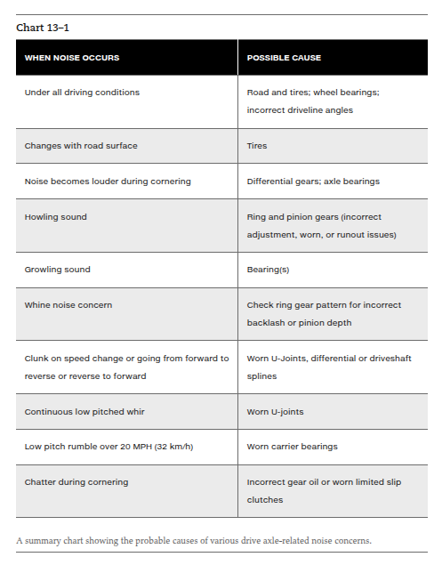
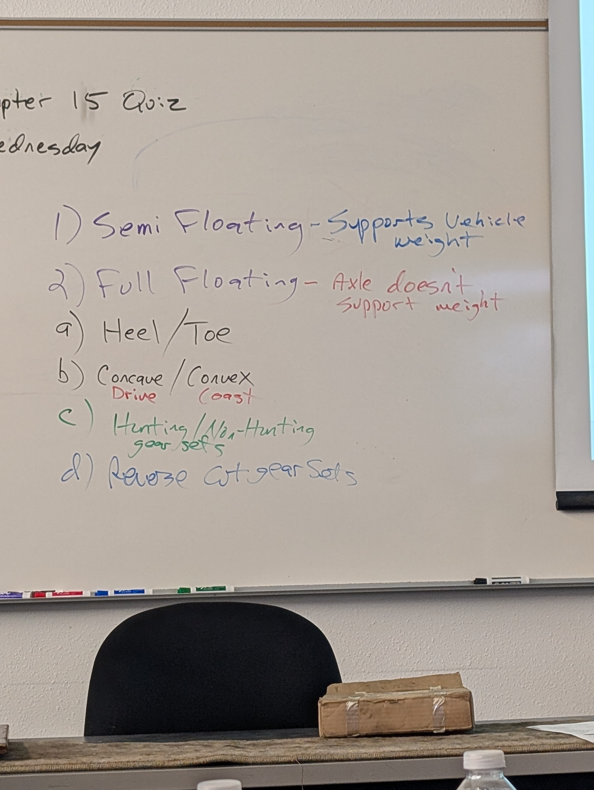

# Unit 3 Study Guide — Drive Axles and Rear Final Drive

**Version 2 · GM ASEP A3 · Notes-led working draft · Updated September 18, 2026**

This guide reorganizes `drive-axles.txt` and the two images referenced by those notes. It uses the Unit 2 exam only to imitate the instructor's question formats. The September 18 differential section keeps the instructor's examples while separating mechanisms that the raw notes group together; those distinctions were checked against the manufacturer sources recorded in the research foundation. It does not import unrelated professional-A3 topics that are absent from Unit 3.

> **Pending cross-check:** the Unit 3 exam file is not currently visible in the folder. When it appears, use it to verify coverage, diagram types, instructor wording, and question traps before treating this as the final version.

## What to know first

The most repeated or developed ideas in the current notes are:

1. Gear whine versus bearing growl/rumble, then pinion versus carrier versus axle/wheel-bearing clues.
2. Diagnosing a rear axle under drive, cruise, float, coast, cornering load, and road-surface changes.
3. Open, clutch-type limited-slip, helical limited-slip, automatic-locking, and selectable-locking differentials.
4. The GM/Eaton mechanical locker sequence emphasized in class.
5. Semi-floating versus full-floating axle load paths.
6. Hypoid ring-and-pinion construction and tooth terminology.
7. Heel/toe, face/flank, convex/concave, and drive/coast sides.
8. Hunting, non-hunting, and partially non-hunting gear sets.
9. Reverse-cut gear sets in front-axle applications.
10. Backlash, pinion-bearing preload, and collapsible/crush-sleeve setup.
11. Carrier types, axle retention, fluid level, vents, and ABS sensor contamination.

## How to answer instructor-style questions

The prior unit exam favored Technician A/B, EXCEPT, symptom-to-cause, and component-identification questions. For Unit 3:

- Separate **sound type** from **when it occurs**.
- Identify whether the axle is under **drive, coast, float, cornering, or torque reversal**.
- Separate **gear adjustment** from **bearing condition**.
- Identify the **differential design** before applying a fluid, lockup, or service rule.
- For Technician A/B, judge each statement independently.
- For an EXCEPT question, name the shared rule before selecting the exception.
- For a measurement question, identify what the tool is measuring: clearance, runout, endplay, or rotating torque.

---

## 1. Rear-drive power direction

In the class comparison:

- A longitudinal RWD engine, transmission, and propeller shaft rotate along the length of the vehicle.
- The rear axle must turn that power flow approximately 90 degrees toward the wheels.
- The hypoid ring-and-pinion set performs that direction change and provides final reduction.
- A typical transaxle final drive does not need the same 90-degree hypoid arrangement because its layout already places the final-drive members in the needed orientation.

The final-drive ratio is selected as a compromise between cruise rpm and low-speed torque.

---

## 2. Gear noise versus bearing noise

| Sound | First classification | Notes-based description |
|---|---|---|
| Whine/howl | Gear noise | Often changes with drive/coast load or incorrect ring-and-pinion adjustment |
| Growl/rumble/grating | Bearing noise | Rougher than gear whine; may pulse or produce a “wow-wow” sound at shaft frequency |
| Clunk | Excessive slack/clearance | Heard or felt when power direction reverses or power is applied from neutral |
| Chuckle | Differential clearance | Playing-card-against-spokes sound during deceleration below about 40 mph in the textbook passage |
| Chatter on corners | Limited-slip clutch action | Stick/slip from incorrect lubricant/friction condition or worn clutch plates |

### Road-test conditions

Know what each condition changes:

| Condition | Driver action | Gear load idea |
|---|---|---|
| **Drive** | Light/moderate throttle acceleration or heavy pull | Engine drives vehicle; drive side loaded |
| **Cruise/road load** | Hold constant speed and throttle | Gear teeth stay loaded steadily |
| **Float** | Just enough throttle to keep engine load off the driveline while speed falls slowly | Very little load; lash split between tooth sides |
| **Coast** | Closed-throttle deceleration | Vehicle drives engine; coast side loaded |
| **Coast in neutral** | Neutral during coast when the procedure permits | Helps separate transmission-related noise from road-speed axle/tire noise |

If a whine changes sharply between drive and coast, think about which side of the ring-gear tooth is loaded. If a noise changes with the road surface, move tires high on the list. If it changes during cornering, consider bearings or differential parts whose load or motion changes in a turn.

### Noise-chart recall

| Complaint | Direction from the class chart |
|---|---|
| Noise under all driving conditions | Road/tires, wheel bearings, or incorrect driveline angles |
| Changes with road surface | Tires |
| Louder while cornering | Differential gears or axle/wheel bearings |
| Howling | Ring-and-pinion adjustment, wear, or runout |
| Growling | Bearings |
| Whine | Check backlash and pinion-depth/contact-pattern direction |
| Clunk during speed or forward/reverse changes | U-joints, differential clearance, or driveshaft splines |
| Continuous low-pitched whir | Worn U-joints in the chart |
| Low-pitched rumble above about 20 mph | Carrier-bearing direction in the chart |
| Chatter during cornering | Incorrect limited-slip lubricant or worn clutches |

Treat the chart as a first direction. More than one component can produce a similar sound, so use operating conditions to narrow it.

### Bearing and tire localization from the new class notes

| Suspect | Useful clue | Why it helps |
|---|---|---|
| Pinion bearings | Faster-pitched growl/grating sound whose pitch climbs quickly with road speed; often less sensitive to drive versus coast than gear whine | Pinion bearings rotate at driveshaft/pinion speed, faster than carrier and axle bearings |
| Carrier/side bearings | Lower-frequency growl/rumble; load may change it; a lightly loaded hoist test may reduce it | Carrier bearings rotate with the differential case and depend on the carrier's load and support condition |
| Axle or wheel bearing | Road-speed sound that changes as cornering shifts wheel load; use sound location, feel, roughness, and looseness together | The bearing follows wheel/axle speed and its load changes during a controlled swerve |
| Tire | Pitch can resemble a bearing; road surface, tire rotation, visual wear, and an unloaded lift test may change or remove it | Tread contact creates the sound rather than an internal axle member |

The instructor's fast-versus-slow pitch comparison is a localization tool, not a one-observation verdict. A gear whine is usually load sensitive and often fades in float. A bearing growl is more closely tied to rotational speed, but bearing load can still change its volume. A noise becoming quiet on a lift does not by itself prove a side bearing, tire, or any single component.

*Class noise-diagnosis chart referenced directly by `drive-axles.txt`.*

---

## 3. Semi-floating and full-floating axles

### Semi-floating

- Common on light-duty vehicles and half-ton pickups in the class notes.
- Axle shaft transfers torque **and supports vehicle load**.
- Outer axle bearing supports the shaft in the housing.
- Depending on the retention design, a broken shaft can allow the wheel/shaft to separate.
- Passenger-car/light-pickup examples may use an inner C-lock or an outer bearing retainer.

### Full-floating

- Axle shaft mainly transfers torque.
- Wheel hub rides on tapered roller bearings supported by the housing/spindle.
- Hub bearings carry vehicle weight into the axle housing.
- Axle shaft does not support vehicle weight in the same way as a semi-floating shaft.

### The test-ready distinction

| Design | Axle shaft carries torque | Axle shaft carries vehicle load |
|---|---:|---:|
| Semi-floating | Yes | Yes |
| Full-floating | Yes | No; hub bearings carry load into housing |

Memory: **semi = shaft does two jobs; full = shaft carries torque while the hub carries weight.**

---

## 4. Hypoid ring-and-pinion set

### Construction and purpose

- The drive pinion meshes below the ring-gear centerline in the hypoid arrangement described in the notes.
- The offset lowers the driveshaft/tunnel and permits a larger, stronger pinion.
- Teeth slide/wipe across each other, helping quiet operation but requiring the specified hypoid lubricant.
- Ring and pinion are cut, hardened, ground, and lapped together.
- They become a matched set. Damage to one normally means replacement of the pair.
- Identification marks may show the matched set, ratio/part number, or pinion-depth information.

### Tooth terminology

| Term | Meaning |
|---|---|
| Heel | Outer end of ring-gear tooth |
| Toe | Inner end of ring-gear tooth |
| Face | Tooth area above pitch line |
| Flank | Tooth area below pitch line |
| Drive side | Vertical, convex side in the class/textbook description |
| Coast side | Slanted, concave side in the class/textbook description |

The pitch line is the design center of gear contact, roughly halfway up the tooth.

### Drive, coast, and float on the tooth

- **Drive:** pinion drives ring gear; drive/convex side carries load; backlash is at coast side.
- **Coast:** ring gear drives pinion as vehicle drives engine; coast/concave side carries load; backlash is at drive side.
- **Float:** little or no load; lash is split between both sides.

The words **convex** and **concave** describe tooth shape. The words **drive** and **coast** describe which side is loaded under an operating condition.

*Class whiteboard: semi-floating/full-floating, heel/toe, concave/convex, hunting relationships, and reverse-cut gear sets.*

---

## 5. Hunting and timing relationships

### Hunting gear set

- Tooth-count fraction cannot be reduced to lower terms.
- Example: `41/11 = 3.73:1`.
- Each pinion tooth eventually contacts every ring-gear tooth.
- No timing marks are required for tooth pairing.
- The notes identify hunting as the most common type.

### Non-hunting gear set

- Ratio reduces to a whole number.
- Example: `39/13 = 3:1` or `40/10 = 4:1`.
- Each pinion tooth repeatedly contacts the same subset of ring-gear teeth.
- Timing marks are required so lapped tooth relationships are preserved.

### Partially non-hunting gear set

- Tooth-count fraction is reducible but does not reduce to a whole number.
- Example: `42/12 = 7/2 = 3.5:1`.
- A pinion tooth contacts only part of the ring gear before the relationship repeats.
- Timing marks are required.

### Quick classification method

1. Write ring teeth over pinion teeth.
2. Reduce the fraction.
3. Irreducible original fraction → hunting.
4. Whole number → non-hunting.
5. Reducible non-whole fraction → partially non-hunting.

---

## 6. Reverse-cut gear sets

- Reverse-cut teeth spiral in the opposite direction from a standard gear set.
- Some front axles made from a rear-style arrangement would otherwise drive the standard gear's coast side, which is weaker in the notes' example.
- A purpose-designed reverse-cut set lets the front axle carry forward-driving load on the intended strong side.
- The arrangement can place the pinion above the ring-gear centerline, decreasing front driveshaft angle on lifted vehicles.
- The housing needs oiling passages appropriate to that gear position.

Do not reduce “reverse cut” to running a normal gear backward. Tooth spiral, housing, pinion position, load side, and lubrication are part of the design.

---

## 7. Gear mounting, carriers, and lubrication

### Ring, pinion, and bearings

- Ring gear attaches to the differential case/carrier.
- Carrier is supported by tapered roller carrier/side bearings.
- Gear separation forces try to push the ring and pinion apart under load.
- Pinion preload and carrier support keep the relationship controlled.

### Carrier types

- **Removable carrier:** center carrier assembly unbolts and removes from the axle housing; older “banjo” housing example.
- **Integral carrier:** axle tubes are part of/welded to the main carrier housing; removable rear cover gives service access; also called Salisbury or Spicer in the notes.

### Lubrication and fluid level

- Rear drive axle uses splash lubrication in the class notes.
- Fluid level is not automatically exactly even with the fill hole. Some applications specify a distance below it.
- Use the specified lubricant for the hypoid gear set and any limited-slip clutches.

### ABS reluctor and sensor notes

- Older three-channel ABS may use one rear speed sensor at the driveshaft flange, pinion, or ring gear.
- Other designs use sensors near each axle/wheel hub.
- Magnetic sensors in the housing can be affected by metal particles.
- Axle-end sensors can be affected by worn axle bearings.

---

## 8. Open, limited-slip, and locking differentials

**Exam-level map first:** open allows normal differentiation, limited slip resists excessive speed difference, and a locker can couple both axle outputs. Go deeper only when the question names a mechanism. The GM/Eaton sequence below matters because it was taught directly in class.

### Open differential and brake traction control

- The differential case turns with the ring gear.
- Straight ahead, the spider/pinion gears travel with the case but normally do not rotate on their own shaft because both side gears turn together.
- A left/right speed difference makes the spider gears rotate on their shaft and lets the side gears turn at different speeds.
- Brake-based traction control can use the ABS hydraulic system to brake a spinning wheel so the open differential has reaction torque available on that side. That electronic intervention does not convert the carrier into a mechanical locker.

### Clutch-type limited slip

The class model places clutch packs behind the side gears. Gear-separating thrust loads the side gears outward into the clutch packs. The clutch friction resists left/right speed difference and biases more usable torque toward the wheel with traction while still permitting differentiation. During a turn, the spider gears rotate on their shaft; that motion identifies differentiation, but the clutch apply force comes from side-gear thrust and the clutch arrangement.

“Positraction” is commonly used for a limited-slip product or feature. Do not use **limited slip**, **positraction**, and **locker** as automatic synonyms: a limited-slip unit resists differentiation, while a fully locked differential mechanically couples both axle outputs to the case.

### Helical/Torsen-type limited slip

- Uses helical gearing and the thrust/friction created under torque to bias torque between outputs.
- It is a torque-biasing limited-slip differential, not a fully locking differential.
- It does not use the same clutch-pack mechanism or fluid rule as a clutch-type limited slip.

### GM/Eaton mechanical locker emphasized in class

Use this event order:

1. A left/right wheel-speed difference spins the governor mechanism.
2. A flyweight catches the stationary latching bracket and stops/slows the governor action.
3. The cam plate moves relative to the cam side gear and climbs its ramps.
4. The cam action applies the clutch packs with a self-energizing effect.
5. Both side gears are held to the case, so the axle reaches full lock.
6. Above roughly 20 mph, the latching bracket moves away from the flyweight path and prevents lockup; when the traction difference ends, unlocking is automatic.

The useful distinction is **automatic trigger plus mechanical lock**. This GM/Eaton example operates open/light-bias during normal driving and locks only under its designed low-speed wheel-difference conditions.

### Selectable and automatic lockers

- An Eaton ELocker uses an electromagnetic actuator to lock a side gear to the differential case when commanded.
- An air locker uses pneumatic actuation. Its internal locking member depends on the design.
- Do not assume every electric or air locker applies a clutch pack; selected lockers commonly move a locking collar or equivalent positive-lock member.
- A Detroit Locker is an automatic locker with a different operating strategy from the GM/Eaton governor-and-cam unit. Identify the model before applying an engagement rule.

### One-glance comparison

| Design | Normal behavior | Traction action |
|---|---|---|
| Open + brake traction control | Open differential | ABS-based brake intervention creates reaction torque at the spinning side |
| Clutch-type limited slip | Differentiates with clutch resistance | Side-gear thrust loads clutch packs and limits speed difference |
| Helical/Torsen-type limited slip | Smooth torque-biasing differential | Helical-gear thrust/friction biases torque; does not become a full locker |
| GM/Eaton mechanical locker | Open/light-bias in ordinary driving | Governor, latch, cam, and clutches produce automatic low-speed full lock |
| Selectable electric/air locker | Open until commanded | Actuator positively locks an output to the case using the design's locking member |

---

## 9. Backlash, preload, and the crush sleeve

### Backlash

Backlash is the clearance between ring and pinion teeth. Excessive slack can contribute to a clunk when torque reverses. A whine/contact concern can direct you toward checking backlash and pinion depth.

### Pinion-bearing preload

Preload is controlled initial bearing load. The notes emphasize checking it with a **rotating torque wrench**. Do not confuse:

- the large tightening torque required to collapse a sleeve, and
- the smaller rotating torque used to evaluate bearing preload.

### Collapsible/crush sleeve sequence

1. New sleeve starts too long.
2. It sits between the pinion-bearing arrangement described in class.
3. Tightening the pinion/yoke nut compresses the sleeve.
4. Bearings seat into their races.
5. Continue carefully until specified rotating preload is reached.

The crush sleeve is a one-time-use setup part. If setup must be redone, replace it rather than treating it as a reusable adjustment spacer.

The notes describe a seal-replacement approach in which original total rotating torque is measured before disassembly and restored with a small specified increase during reassembly. Treat this as an application-specific procedure: the important class idea is to preserve the established preload while following the actual service information.

---

## 10. Service and inspection reminders

- Most drive-axle complaints fall into noise, vibration, leaks, or failure to transmit power.
- Do not assume a noise originates where it is heard; exhaust, tires, wind, and body/frame contact can transmit sound.
- A hoist or safety stands may help isolate drivetrain noise, with load simulated briefly by the brake only when the procedure and shop safety permit it.
- A repeated seal leak can be connected to shaft/bearing movement or a vent concern, not only the seal itself.
- Inspect axle splines, bearings, seals, and retainers when a semi-floating axle shaft is removed.
- Limited-slip lubricant must reach the clutch plates after service; the textbook procedure describes repeated figure-eight turns after the correct fluid change.

---

## High-value distinctions

| Do not mix up | Correct distinction |
|---|---|
| Gear noise / bearing noise | Whine-howling / growl-rumble-grating |
| Drive / coast / float | Engine drives / vehicle drives / little tooth load |
| Semi-float / full-float | Shaft carries torque + weight / shaft mainly carries torque |
| Heel / toe | Outer tooth end / inner tooth end |
| Face / flank | Above pitch line / below pitch line |
| Convex / concave | Drive side / coast side in current class description |
| Backlash / preload | Gear-tooth clearance / bearing load |
| Tightening torque / rotating torque | Force used to collapse sleeve / measurement used to evaluate preload |
| Hunting / non-hunting | Every-tooth relationship / repeating tooth subset |
| Removable / integral carrier | Center section removes / rear cover removes |
| Limited slip / locker | Resists speed difference / mechanically couples the outputs for full lock |
| Clutch-type / helical limited slip | Clutch-pack friction / gear-thrust friction |
| GM/Eaton mechanical locker / ELocker | Automatic governor-cam trigger / commanded electromagnetic actuation |
| Pinion / carrier / axle-bearing speed | Fastest / differential-case speed / wheel speed |

---

## Original instructor-style practice

### Questions

1. A rear axle produces a high-pitched whine that changes between acceleration and deceleration. Which area should be investigated first?  
   A. Ring-and-pinion contact/setup  
   B. Clutch pedal switch  
   C. Transmission blocker ring  
   D. Engine mount only

2. Technician A says a rough growl is more typical of bearing noise. Technician B says a gear whine may change as tooth load moves from drive to coast. Who is correct?  
   A. A only  
   B. B only  
   C. Both A and B  
   D. Neither A nor B

3. During which road-test condition is tooth load minimized and lash effectively split between both sides?  
   A. Heavy drive  
   B. Cruise  
   C. Float  
   D. Closed-throttle coast

4. A noise changes noticeably when the vehicle moves onto a different road surface. What is the best first direction?  
   A. Tires  
   B. Pinion crush sleeve  
   C. Limited-slip clutch pack  
   D. Axle ratio

5. A semi-floating axle shaft carries:  
   A. Torque only  
   B. Vehicle weight only  
   C. Torque and vehicle load  
   D. Neither torque nor load

6. Technician A says full-floating hub bearings transfer vehicle load into the housing. Technician B says the full-floating axle shaft primarily transfers torque. Who is correct?  
   A. A only  
   B. B only  
   C. Both A and B  
   D. Neither A nor B

7. Which is the **least** accurate description of a semi-floating axle?  
   A. The shaft supports vehicle load  
   B. The shaft transfers torque  
   C. The hub bearings carry all vehicle load independently of the shaft  
   D. Shaft retention design affects what happens after breakage

8. In the hypoid arrangement described in the notes, the pinion is located:  
   A. Above the ring-gear centerline  
   B. Below the ring-gear centerline  
   C. On the axle-shaft centerline with no offset  
   D. Inside the transmission

9. The outer end of a ring-gear tooth is the:  
   A. Toe  
   B. Heel  
   C. Flank  
   D. Pitch line

10. Technician A says the drive side is convex in the class description. Technician B says the coast side is concave. Who is correct?  
    A. A only  
    B. B only  
    C. Both A and B  
    D. Neither A nor B

11. During coast, which statement is correct?  
    A. The drive side carries all load and backlash is on the coast side  
    B. The coast side is loaded and backlash moves to the drive side  
    C. Both tooth sides carry equal heavy load  
    D. The ring gear stops turning

12. A ring gear has 41 teeth and the pinion has 11 teeth. The fraction cannot be reduced. This is:  
    A. Hunting  
    B. Non-hunting  
    C. Partially non-hunting  
    D. Direct drive

13. A gear set uses 39 ring teeth and 13 pinion teeth. Which is correct?  
    A. It is hunting and needs no timing marks  
    B. It is non-hunting and uses a repeating tooth relationship  
    C. It is partially non-hunting  
    D. It has a 2:1 ratio

14. A gear set uses 42 ring teeth and 12 pinion teeth. The ratio reduces to 7/2. It is:  
    A. Hunting  
    B. Non-hunting  
    C. Partially non-hunting  
    D. A 1:1 set

15. Which gear-set type allows each pinion tooth eventually to contact every ring-gear tooth?  
    A. Hunting  
    B. Non-hunting  
    C. Reverse only  
    D. Integral carrier

16. Reverse-cut gears are used in the notes' front-axle example mainly so that:  
    A. The axle can drive on the intended stronger tooth side  
    B. The ring gear no longer needs lubricant  
    C. Backlash becomes zero  
    D. The axle becomes semi-floating

17. Metal debris inside an axle housing can disturb some ABS sensors because they:  
    A. Include a magnetic core  
    B. Measure clutch free play  
    C. Control pinion preload  
    D. Replace the carrier bearings

18. Which carrier design normally gives access through a removable rear cover?  
    A. Integral/Salisbury-style carrier  
    B. Removable/banjo-style carrier  
    C. Full-floating hub  
    D. Hunting carrier

19. Technician A says every axle should be filled exactly to the bottom of the fill hole. Technician B says the specified level may be a measured distance below the hole. Who is correct?  
    A. A only  
    B. B only  
    C. Both A and B  
    D. Neither A nor B

20. A clutch-type limited-slip axle chatters during tight turns after service. What should be checked first?  
    A. Correct specified axle lubricant/friction treatment  
    B. Transmission shift-rail interlock  
    C. Clutch master cylinder  
    D. Flywheel ring gear

21. A clunk is heard when changing from drive to coast or forward to reverse. Which general condition fits best?  
    A. Excessive driveline slack/clearance  
    B. Zero backlash  
    C. A hunting tooth-count ratio  
    D. Normal float condition

22. Pinion-bearing preload is evaluated with:  
    A. Engine compression  
    B. Rotating torque  
    C. Clutch pedal height  
    D. Tire circumference

23. Technician A says the torque used to collapse a crush sleeve can be very high. Technician B says the final bearing preload is judged by the resulting rotating torque. Who is correct?  
    A. A only  
    B. B only  
    C. Both A and B  
    D. Neither A nor B

24. A crush sleeve has already been used to establish pinion-bearing preload and the setup must be repeated. The notes support:  
    A. Reusing it indefinitely  
    B. Replacing it as a one-time-use part  
    C. Removing the carrier bearings  
    D. Changing tire pressure

25. All of these are useful drive-axle road-test load conditions **EXCEPT**:  
    A. Drive  
    B. Cruise  
    C. Float  
    D. Clutch-pedal free play

26. When a conventional open differential travels straight ahead with equal wheel speeds, the spider/pinion gears normally:  
    A. Rotate rapidly on their own shaft  
    B. Travel with the case without rotating on their own shaft  
    C. Lock both side gears to the housing  
    D. Stop the ring gear

27. In the clutch-type limited-slip model discussed in class, what loads the clutch packs?  
    A. Side-gear separating thrust  
    B. Pinion-bearing rotating torque  
    C. ABS wheel-speed voltage  
    D. Axle-shaft runout

28. Which sequence best describes the GM/Eaton mechanical locker discussed in class?  
    A. Driver switch → electric motor → transfer-case fork  
    B. Wheel-speed difference → governor/flyweight latch → cam ramp → clutch apply/full lock  
    C. Tire pressure difference → ABS fuse → helical gears  
    D. Pinion depth change → crush sleeve → axle lock

29. A helical/Torsen-type differential is best classified as:  
    A. A clutch-type unit requiring the same friction rule  
    B. A torque-biasing limited slip that uses helical-gear thrust/friction  
    C. A permanently welded differential  
    D. A selectable air locker

30. Technician A says an Eaton ELocker uses electromagnetic actuation. Technician B says every air or electric locker applies clutch packs in the same way. Who is correct?  
    A. A only  
    B. B only  
    C. Both A and B  
    D. Neither A nor B

31. A rough growl rises in pitch very quickly with road speed and changes little between drive and coast. Which class-note direction is strongest?  
    A. Pinion bearings  
    B. Clutch master cylinder  
    C. Ring-gear tooth count  
    D. Shift-rail detent

32. A slower road-speed growl changes during a controlled swerve. Which direction should remain high on the list?  
    A. Axle/wheel bearing load response  
    B. Clutch-pedal free play  
    C. Synchronizer blocker ring  
    D. Flywheel ring gear

### Answer key

1. **A** — load-sensitive whine points toward ring-and-pinion contact/setup.  
2. **C** — both match the notes' sound and load distinctions.  
3. **C** — float removes most tooth load.  
4. **A** — road-surface response points toward tires.  
5. **C** — the semi-floating shaft carries torque and vehicle load.  
6. **C** — hub bearings carry load; the shaft primarily carries torque.  
7. **C** — that statement describes the full-floating load path.  
8. **B** — the hypoid pinion is below centerline in the described arrangement.  
9. **B** — heel is outer; toe is inner.  
10. **C** — both match the class/textbook terminology.  
11. **B** — coast reverses tooth loading and moves clearance to the drive side.  
12. **A** — the irreducible tooth-count fraction is hunting.  
13. **B** — `39/13 = 3`, a whole-number non-hunting relationship.  
14. **C** — it reduces but not to a whole number.  
15. **A** — that every-tooth relationship defines hunting.  
16. **A** — reverse cut puts forward drive on the intended strong side in the front-axle example.  
17. **A** — metal can collect at a magnetic sensor core.  
18. **A** — the integral/Salisbury-style housing uses a rear cover.  
19. **B** — use the application specification rather than assuming the fill-hole edge.  
20. **A** — limited-slip clutch friction depends on the specified lubricant/treatment.  
21. **A** — torque reversal takes up excess lash in joints, splines, and differential parts.  
22. **B** — the notes emphasize rotating torque.  
23. **C** — tightening effort collapses the sleeve; rotating torque evaluates the bearing load.  
24. **B** — the sleeve is treated as one-time use.  
25. **D** — clutch-pedal free play is unrelated to the four axle load states.
26. **B** — equal side-gear speeds let the spiders travel with the case without spinning on their shaft.  
27. **A** — side-gear separating thrust applies the clutch-pack load in this design.  
28. **B** — that is the class-taught automatic lock sequence.  
29. **B** — a helical unit biases torque through gear thrust/friction and is not a full locker.  
30. **A** — ELocker actuation is electromagnetic, but locking members differ among designs.  
31. **A** — pinion bearings rotate faster, so their growl can climb in pitch quickly and be less load-sensitive than tooth whine.  
32. **A** — cornering changes axle/wheel-bearing load; confirm with location, feel, and inspection.

---

## Final recall check

Without looking back, explain:

1. Why does a RWD rear axle need a direction-changing final drive?
2. How do drive, coast, and float change tooth loading?
3. Which axle design makes the shaft carry vehicle weight?
4. Where are heel, toe, face, and flank?
5. Why are ring and pinion replaced as a matched set?
6. How do you classify hunting relationships from tooth counts?
7. Why is a reverse-cut front gear set different from turning a standard rear set around?
8. What is the difference between backlash and preload?
9. Why are tightening torque and rotating torque different during crush-sleeve setup?
10. Which observations separate tire, gear, bearing, lash, and limited-slip noises?
11. How do clutch-type limited slip, helical limited slip, and full locking differ?
12. Trace the GM/Eaton governor, latch, cam, clutch, and lock sequence.
